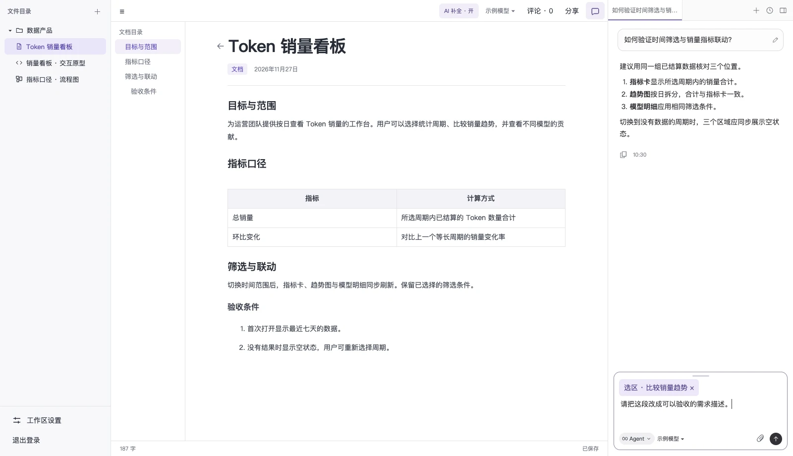

# 叙页 · PRD Agent

叙页是给产品经理使用的单人在线工作台。把需求文档、交互 HTML、原型画布放在同一棵文件树里，在任一文件中打开 Agent 对话，就可以围绕当前内容提问、跨文件修改，或创建一组新的交付物。Agent 基于 Pi Durable，文档使用 Tiptap，画布使用 Excalidraw。

在「客户反馈池」这类需求文档中，可以选中一句指标口径，问 Agent 怎么写得更清楚。采纳修改后，同一工作区里的 HTML 原型仍可单独演示，分享开关控制外部读者能否打开链接。




## 本地启动

使用 Node.js 24 和 npm。在仓库根目录执行：

```sh
npm ci
npm ci --prefix server
npm run build
npm start
```

浏览器打开 [本地工作台](http://127.0.0.1:4317/)。首次启动账号为 `admin`，随机密码在 `.private/首次登录密码.txt`。首次启动前可设置 `XUYE_USERNAME` 和 `XUYE_PASSWORD`。已有账号继续使用数据库中的凭据。

`npm run build` 生成离线单文件 `叙页产品需求工作台.html` 和在线资源目录 `.web/`。在线页面按内容哈希缓存脚本和样式，支持 gzip。每次修改前端后重新运行 `npm run build`，修改服务端后重启 Node。完整的模型、存储与分享能力通过登录版使用。Linux 的 Bash 和原型截图分别需要 bubblewrap 和 Chromium，安装与托管方式见[部署说明](部署说明.md)。

## 连接模型

1. 打开**工作区设置 → 供应商管理**，列表会显示已保存的供应商、接口地址和模型数量。点击一条记录可重新编辑；点击「新增供应商」打开空白表单，填写名称、Base URL 和 API Key。Base URL 应包含供应商要求的版本前缀，例如 `https://api.example.com/v1`。远程地址使用 HTTPS，本机兼容服务也支持 loopback HTTP。
2. 点击「获取模型列表」从该地址的 `GET /models` 发现模型，或每行手动填写一个模型 ID。可测试首个模型后保存。保存后会回到供应商列表。
3. 在 Agent 输入框下方选择对话模型，在文档或 HTML 源码的 AI 补全开关旁选择补全模型。列表按 Base URL 分组，可按名称、模型 ID 或地址搜索。同名模型通过供应商区分。两处选择独立保存，下一次请求使用新选择。
4. 修改供应商时，密钥留空可沿用同一地址的凭据。更换地址时需要重新输入密钥。删除模型后，默认选择会移到仍可用的模型。

新工作区的供应商列表为空。供应商密钥用 AES-256-GCM 加密后写入工作区数据库，解密密钥在数据目录的 `master.key`。浏览器获取的是配置元数据与模型 ID。升级旧工作区时，服务按接口地址和原有凭据合并旧配置，并迁移原有模型选择。

兼容接口使用 `POST /chat/completions`。Agent 需要流式响应及工具调用能力，图片问答还需要模型支持图像输入。测试首个模型检查普通文本调用。自行设置模型输出上限时，请与实际供应商的窗口和输出限制匹配。

## 在工作台中工作

点击工作台左上角的 ☰ 可以展开或收起文件目录。目录中的 ＋ 可以新建文件夹、文档、原型画布和 HTML。手动编辑会自动保存到当前在线文件，连续输入时默认在停顿 600 毫秒后保存。Agent 对已有文件提出的修改可以先预览，点击 Keep 后写入同一文件。

- **文档**支持图文、表格、行级工具栏、划词与框选格式化。有 H1–H4 标题时，文档区左上角的箭头可随时展开或收起章节目录。打开 AI 补全后，输入会触发 Markdown 续写或纠错建议，生成时光标旁会显示「补全中…」。编辑器用红色标出将删除的原文、绿色标出新增内容。双按 Tab 立即生成或换一版，单按 Tab 采纳，Esc 取消。标题、列表和代码块按文档格式插入。
- **HTML** 是单文件原型。Raw Text 提供语法高亮、划词悬浮工具栏和行内代码补全，与文档共用补全开关、模型和快捷键。Agent 提议的源码修改可在渲染模式下预览。可以逐处保留或放弃修改。
- **原型画布**支持编辑图形和连线。Agent 可以用文件路径或 ID 定位画布，修改内容可在工作台预览。
- **Agent 对话**默认携带当前文件上下文。“给这个页面加字段”“继续写这一节”等请求优先在当前文件上提出修改。需要独立交付时，可以明确要求创建新的 PRD、HTML 或画布。对话可以粘贴图片，或点击回形针一次上传多个图片、PDF、Word、Excel 附件。在文件目录点击文件旁的引用按钮或将文件拖入对话，可将其作为当前会话的引用。外部 API 的请求地址和要求可直接写在消息中。工具执行详情可展开查看。正在处理时仍可发送消息，待发送队列显示在输入框上方。默认按发送顺序执行。点击任一条的「立即发送」会中断当前执行，保留工具记录并优先处理该条消息。其余消息保持原有顺序。若产生待采纳修改，处理后队列继续。
- **划词提问**支持文档正文和 HTML 的 Raw Text。选中文字后点击选区旁的「问 Agent」，或将选区拖入助手，输入框会显示选区摘要。服务端核对源文件版本和字符区间，修改建议只应用到这段选区。
- **会话**关联发起文件和每轮新建、编辑的文件。从产物打开助手会看到最近使用的关联会话。双击标签可重命名。在历史按钮下方可以选择会话或从所有关联文件中删除它。点击提问或回复旁的分支按钮，可继承截至该条消息的上下文和文件关联。每个分支拥有独立队列和后续执行记录。输入或粘贴 Markdown 后，标题、列表和代码块直接在输入框中排版，可以继续编辑。按 Shift+Enter 换行，按 Enter 发送。拖动输入框上边缘可调整高度。
- **文件地址**采用 `/{账号}/{文件 UUID}`。账号首页默认打开目录中的首份文档，目录切换、刷新、前进和后退都使用文件地址。启动时仅传目录与会话索引，正文、画布和对应会话在打开文件时读取。
- **分享**使用相同的文件地址。所有者登录后编辑，访客在开启分享时可查看内容并评论。私有文件引导访客登录。旧版已发出的分享链接继续使用原来的开关。分享通过「分享」中的开关控制。关闭立即撤销链接访问，重新开启可继续使用原链接。
- **技能**在「工作区设置 → Agent 工具与技能」管理。仓库附带可替换的 `prd-writing` 技能，指导 Agent 交付可交互 HTML 和图文 PRD。用户可导入其他技能包。

## 代码结构和二次开发

前端从 `src/main.js` 启动。文档编辑与补全在 `src/editor/`，对话在 `src/chat/`，文件目录、画布和供应商界面在 `src/workspace/`，分享评审在 `src/review/`。工作区示例、旧数据迁移、交付文件归档分别放在 `src/workspace/example.js`、`shared/migrate-directory.mjs` 和 `deliveries.js`。前后端共用的范围编辑、文件类型、引用和画布模型在 `shared/`。

服务端从 `server/index.mjs` 启动。Agent 循环、队列和历史在 `server/agent/`，分享与撤销在 `server/sharing/`，模型请求在 `server/models/`，文件生成和修改在 `server/workspace/`，附件解析在 `server/attachments/`，任务环境和网络代理在 `server/runtime/`。

| 需要修改的行为 | 入口 |
| --- | --- |
| Agent 系统指令、文件上下文、用户消息、错误纠正和截断续写提示 | [server/agent/prompts.mjs](server/agent/prompts.mjs) 中的 `agentInstructions`、`agentInput`、`continuationInput` |
| 文档补全提示 | [server/models/completion.mjs](server/models/completion.mjs) 的 `completionMessages` 接收光标前后文、可改写的后文、所在块和代码语言。模型以 JSON 返回原样跳过的前缀 `keep`、删除原文 `remove` 和新增内容 `insert`。服务端检查前两项能否连续匹配光标后的原文。调用端在 [src/editor/inline-completion.js](src/editor/inline-completion.js)。 |
| 在线正文修改 | Tab 采纳和 `edit_online_file` 共用 [shared/online-file-edit.mjs](shared/online-file-edit.mjs)。两个编辑器将候选绑定到文件 ID、正文快照和光标位置。预览由编辑器装饰层绘制。采纳时以一次可撤销的事务写入 Markdown 或源码，后续未标记的内容保留。 |
| 工具循环及重试、压缩策略 | [server/agent/policy.mjs](server/agent/policy.mjs) 的 `loopPolicy`，以及 [server/agent/run.mjs](server/agent/run.mjs) 的 `runAgent` |
| 模型协议、上下文窗口、输出 token 和供应商适配 | [server/agent/model.mjs](server/agent/model.mjs)；普通补全和模型发现在 [server/models/client.mjs](server/models/client.mjs) |
| 工具清单、参数与执行 | [shared/agent-catalog.mjs](shared/agent-catalog.mjs) 的描述和 [server/agent/tools.mjs](server/agent/tools.mjs) 的注册。在线文件的工具参数见 `server/workspace/file-tools.mjs`，目录解析和读写逻辑见 `server/workspace/online-files.mjs`，画布操作见 `server/workspace/canvas-tools.mjs` |
| 技能发现、导入、按需加载 | [server/skills.mjs](server/skills.mjs)、[skills/prd-writing/SKILL.md](skills/prd-writing/SKILL.md) |
| 图片、附件和临时任务目录 | `server/agent/context.mjs`、`server/attachments/attachment-parser.mjs`、`server/runtime/task-environment.mjs` |
| 会话续接、持久化记录和流式展示 | `server/agent/queue.mjs`、`src/chat/chat-queue.js`、`server/agent/conversation.mjs`、`server/agent/history.mjs`、`server/agent/stream.mjs`、`src/chat/chat-trace.js` |
| 供应商存储、选择与管理界面 | `server/models/providers.mjs`、`server/models/routes.mjs`、`src/workspace/providers.js` |
| HTTP 入口、登录和工作区版本 | `server/index.mjs`、`server/storage.mjs`、`src/service.js` |
| 会话与目标文件的对应关系 | [server/agent/routes.mjs](server/agent/routes.mjs) 解析请求所属文件，[server/agent/history.mjs](server/agent/history.mjs) 按文件与会话定位历史；目标文件的待审修改独立归档 |
| 分享开关与旧链接 | [src/review/file-sharing.js](src/review/file-sharing.js)、[server/sharing/files.mjs](server/sharing/files.mjs) |
| 划词定位和写入范围 | [src/editor/selection-reference.js](src/editor/selection-reference.js) 生成原文范围，[server/agent/selection.mjs](server/agent/selection.mjs) 校验并限定写入 |
| 编辑器、HTML、画布和工作区布局 | `src/editor/document-editor.js`、`src/workspace/html-source.js`、`src/workspace/board.js`、`src/shell.html`、`src/style.css` |

### 关键参数

| 行为 | 默认值和含义 | 调整位置 |
| --- | --- | --- |
| Agent 工具循环 | `maxTurns: null`，普通工具轮数不限。工具串行执行，开启 Pi 重试及自动上下文压缩，流超时为 120 秒 | `server/agent/policy.mjs` |
| 错误纠正和截断续写 | `maxCorrections: 2`。纯文本达到输出上限时最多额外续写 3 次。连续 2 次续写都没有推进文件修改时停止自动续写，工具记录保存在会话中 | `server/agent/policy.mjs`、`server/agent/run.mjs` |
| Agent 模型预算 | 模型适配层声明 128,000 token 上下文窗口；`XUYE_MAX_OUTPUT_TOKENS` 默认为 32,768，可设置为 1–127,999。部署时按实际模型支持的上限配置 | `server/agent/model.mjs` |
| 文档及源码补全 | 停止输入 550 ms 自动请求，280 ms 内双按 Tab 立即生成或换一版。请求截取光标前 3,500、后 1,000 个 UTF-16 代码单元，单次输出预算为 1,024 token。自动补全遇到空建议时结束；主动补全首次无建议或编辑格式、定位有误时最多再请求一次 | `src/editor/inline-completion.js`、`server/models/completion.mjs`、`server/agent/routes.mjs` |
| 划词问答 | 请求在 `refs` 中携带 `{kind:"range",id,start,end,text,digest}`。`[start,end)` 对应原始 HTML 源码的 UTF-16 偏移，`digest` 是原文 SHA-256。源文件已改变时需重新选择 | `src/editor/selection-reference.js`、`server/agent/selection.mjs` |
| 对话输入框 | 可拖动上边缘，也可聚焦边缘后按上下键，每次调整 16 px。默认高度 70 px，下限 62 px，上限取 540 px 和窗口高度 52% 中的较小值。偏好保存在浏览器的 `xuye.composerHeight` | `src/chat/composer.js` |

### 工具如何选择

| 操作对象 | 工具 | 标识和用途 |
| --- | --- | --- |
| 在线工作区 | `list_online_files`、`read_online_file`、`write_online_file`、`edit_online_file` | 使用在线文件 ID 或相对整个工作区根目录的路径，例如 `需求/原型`。从 A 开启会话也可以读写 B。读取和修改省略目标时定位 A；在 A 下创建子文件时指定 `parent_id` 为 A 的 ID。 |
| 在线画布和 PRD | `draw_online_canvas`、`embed_view_screenshots` | 按在线文件定位画布，或把配套 HTML 截图嵌入指定文档。 |
| 本次任务的文件系统 | Pi 的 `read`、`write`、`edit`、`bash` | 使用任务目录路径。用 `read` 读取附件解析文本、图片及激活技能的资料，用 `write` 和 `edit` 编写技能与脚本，用 Bash 运行脚本或解析二进制原件。 |
| 工作台技能与会话 | `skill_load`、`compact_context` | 前者按名称加载技能入口。后者是工作台为模型提供的操作，调用 Pi 的 `Conversation.compact`。Pi 自带的阈值压缩和上下文溢出恢复也会自动运行。 |

工作区使用数据库保存文件树。在线工具只在这棵树里解析名称和 ID。比如 `read_online_file({path:"需求/说明"})` 读取在线文档，`read({path:"upload-….txt"})` 读取本次任务的附件。直接修改在线正文可用 `edit_online_file({id:"A",old_text:"原句",content:"新句"})`。长文可用同一工具的 `append` 参数分段追加，并用 `read_online_file` 核对结果。

从 v1.0.x 升级到 v2.0.0 时，如果自定义技能使用旧工具名，请将 `read_file`、`write_file`、`edit_file`、`list_file`、`draw_canvas` 分别改为 `read_online_file`、`write_online_file`、`edit_online_file`、`list_online_files`、`draw_online_canvas`。已有会话的执行记录保留当时的工具名。

新增工作台工具时，在 `shared/agent-catalog.mjs` 声明分组，在 `server/agent/tools.mjs` 注册。在线文件工具由 `server/workspace/` 实现。四个系统工具的名称、参数和描述由锁定版本的 `@earendil-works/pi-durable/tools` 提供。

### Pi Durable 如何管理会话

工作台为每个会话分配独立的 Pi SQLite 存储。同一会话在不同文件中使用同一份执行记录。分支通过 Pi 的祖先可见条目查询读取选定节点及以前的记录，在独立会话库中提交这段记录，并映射上下文压缩边界。消息通过 `Conversation.submit` 提交，服务等待 `Submission.wait` 返回结果。工具的输入和返回值来自已提交的 Pi 记录，界面的实时执行提示订阅 Pi 的 `ToolTask` 钩子。工作台另外负责把用户点击 Keep 的修改应用到相应在线文件。暂停使用 `Conversation.abort`，继续使用 `type: "continue"`。

输入框上方可调整顺序的待发送消息保存在应用定义的 Pi 会话文档中。排队的消息正式提交时，出队和创建 submission 使用同一笔 Pi 事务。服务还用 Pi 事务把工具结果与相应的文件修改快照关联。若进程在工具完成后退出，重新连接原请求会取回已提交的修改与执行记录。交付归档使用单独的工作区事务，同一个已完成答复可以安全重取。

进程在工具执行中退出时，Pi 根据工具声明的 `replay` 策略恢复。`list_online_files` 和 `read_online_file` 只查询在线工作区，显式声明为 `safe`，SDK 可以重新执行。在线写入和画布修改沿用默认的 `unsafe`。锁定的 Pi 1.6.0 中，四个原生系统工具同样使用 `unsafe`。这类调用中断时，模型会收到中断结果，可以先读取实际状态，再决定下一步。已提交的工具结果保存在会话中。[Pi Durable 官方文档](https://github.com/earendil-works/pi/blob/main/packages/durable/README.md)

### 添加技能

每个技能以 `SKILL.md` 为入口，YAML frontmatter 至少包含与目录名一致的 `name` 和说明用途的 `description`。发现阶段只提供元数据。匹配后，`skill_load` 返回入口正文和基准路径。Agent 可按入口说明用 `read` 打开 `references/` 中的资料，用 `bash` 执行 `scripts/` 中的脚本。显式指定 `/skill:名称` 会随当前请求加载入口。也可直接在「工作区设置 → Agent 工具与技能」导入整个文件夹。额外技能搜索路径通过 `XUYE_SKILL_DIRS` 配置。

要在对话中编写可复用技能，可以直接让 Agent 用 Pi 的 `write` 创建 `.agents/skills/review-prd/SKILL.md`，再写入同目录的 `references/checklist.md` 和 `scripts/check.py`。这个目录对应本工作区数据目录的 `skills/`，服务重启后仍可使用。每次向 Agent 发送新消息时，服务都会重新发现技能，把最新的名称和描述放入本次模型请求。创建、修改或删除技能后，继续在同一会话发送消息即可。已发出的请求使用发起时的技能目录。

## HTTP 接口

以下均相对工作台的部署前缀。写请求使用 JSON，附件上传使用文件字节。所有者接口使用登录后获得的 HttpOnly Cookie。

| 方法与路径 | 输入与返回 |
| --- | --- |
| POST `api/login`、`api/logout` | 登录字段为 `username`、`password`、可选 `remember` |
| GET / POST `api/workspace` | 获取目录索引与版本，保存时发送 `{revision,data}`。其他窗口已更新时返回 409 |
| GET `api/workspace/file?id=…` | 获取单个文件和它关联的会话。目录摘要不会覆盖未加载文件的正文 |
| POST `api/agent/fork` | 提交 `{revision,doc,chatId,index,role}`，role 取 user 或 assistant。返回独立分支及新版号 |
| GET `api/models` | 返回 `providers` 和 `selections.agent/completion`；兼容字段 `profiles/active` 仍可读取 |
| POST `api/providers/save` | `{id?,name,base,apiKey?,models:[模型名]}`。返回更新后的目录和 `savedProviderId` |
| POST `api/providers/discover`、`api/providers/test` | `{id?,base,apiKey?}`，测试另传 `model`。分别返回模型名称列表或连通结果 |
| POST `api/providers/delete`、`api/models/switch` | 删除使用供应商 `id`；选择使用模型记录 `id` 和 `scope: "agent" / "completion"` |
| POST `api/agent` | `{mode:"chat",doc,chatId?,question,modelId?}` 或 `{mode:"complete",doc,before,after,blockPath?,atBlockEnd?,modelId?}`。聊天可通过 Accept `application/x-ndjson` 接收 progress、result、error |
| POST `api/agent/queue` | 按 `doc`、`chatId` 获取队列（`list`）、追加消息（`add`）或将指定 `requestId` 移至队首（`prioritize`）。队列保存在 Pi Durable 会话文档中，出队与提交用户输入共用一次事务。 |
| POST `api/agent/pause`、GET `api/agent/history` | 以 `doc` 和 `chatId` 定位会话，暂停携带对应 `attemptId`，历史支持通过 `tool` 查询工具明细 |
| GET `api/agent-catalog`、POST `api/skills/import`、POST `api/skills/delete`、GET `api/skills/export` | 工具与技能目录、技能包导入导出 |
| POST `api/attachments?name=…` | 上传附件字节，单文件上限 20 MB |
| POST `api/share`、GET `s/{token}` | 发送 `{doc,lookup:true}` 查询状态，`{doc,enabled:true/false}` 开关链接。可指定 `file` 和 `version`。公开评审数据位于 `api/public/{token}` |

## 版本与许可证

开发使用 `chelen`，确认通过验收后将同一提交合入 `main`，在 `main` 打版本标签。当前版本为 `v2.0.2`。源码按 [Apache License 2.0](LICENSE) 发布，构建的单文件前端附带依赖的许可声明。
